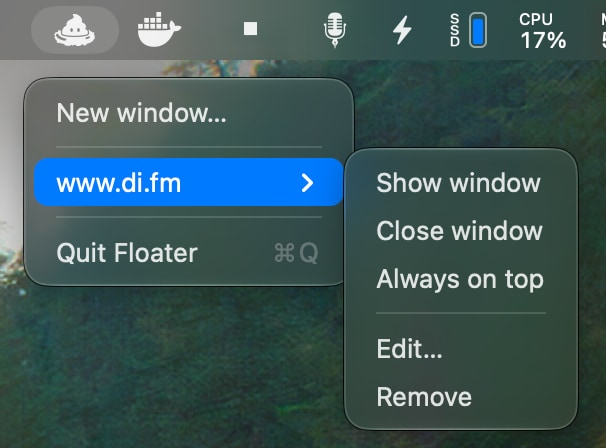

# Floater - URLs as Simple Chromeless Windows

Disclaimer: this project is pure slopfest, 0% of the code is read by a human.

I often want to pin simple Web pages to float on top and/or run independently from my browsers which are in constant
disarray and flux because they're being developed on.

Built as a fully native app using [MyGo](https://github.com/egoist/mygo). Takes <50 MB to run a single window on macOS
27.

## Usage

- Launch the app, add an URL to open in a chromeless window. All future actions can be done via the menubar menu.
- You can move the window with `Option+Click`.

## Elsewhere

- Follow [@uninen on Twitter](https://twitter.com/uninen) or
  [unessa.net on Bluesky](https://bsky.app/profile/uninen.net)

## Contributing

Please don't. Just fork it.
